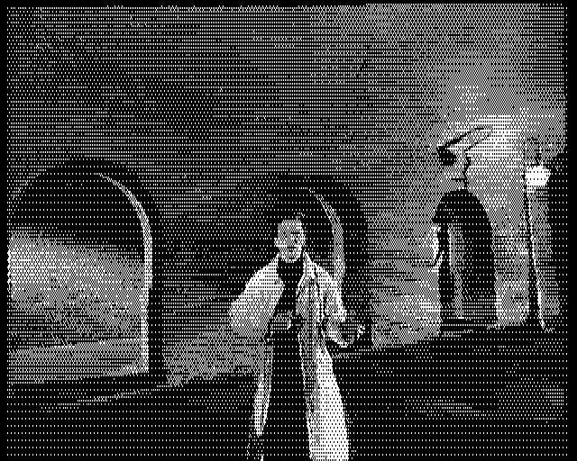
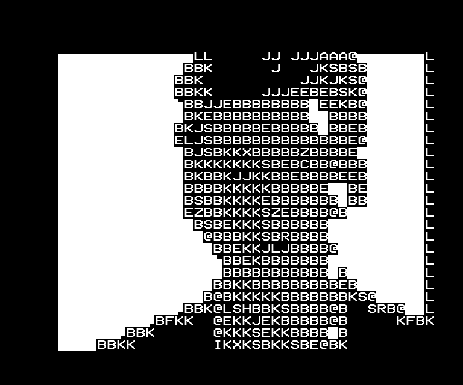

# beeb-remote

Example applications built on a web API for a physical BBC Micro Model B, served by a Pi1MHz on its 1 MHz bus. It can stop
the BBC, read and write its memory, call its code and let it continue. No ROM is needed.

This lets you integrate a physical BBC Micro with anything: web services, AI, databases, other
computers. This repository includes a Python client and three applications: `*CLAUDE`, 50 fps
video, and remote debugging.

To remotely peek and poke a physical BBC Micro in Python:

```python
from bbc import BBC

bbc = BBC("Pi1MHz.local")
bbc.type('PRINT "HELLO"\r')                  # type at the keyboard
print(bbc.screen())                          # read the MODE 7 screen
with bbc.stopped():                          # stop the BBC
    s = bbc.peek(0x044C, 4)                  # read 4 bytes: BASIC's S%
    bbc.poke(0x7C00, b"Hello from Python")   # write 17 bytes to screen memory
                                             # the BBC carries on here
```

## `*CLAUDE`

At the BBC's `>` prompt:

```
>*CLAUDE A LUNAR LANDER IN MODE 2
```

Ask for anything with `*CLAUDE`: Claude
writes it in BBC BASIC, types it in, runs it, reads the screen and any error, and fixes it until
it works, showing its plan on the BBC as it goes. The finished program is left typed in, ready
to `RUN`.

| While Claude works | The game it wrote |
|---|---|
|  |  |

*A real `*CLAUDE` run, captured on an emulated Model B running the real Pi1MHz firmware.*

Here it tried its physics in MODE 7 first, then ran the game in MODE 2 and checked its variables
in memory before handing it over. The game is in [`examples/lander.bas`](examples/lander.bas).

`*CLAUDE` needs a small service running on another computer on your network, such as a
Raspberry Pi 5: see [Setting up](#setting-up).

## Video at 50 frames a second

Video at 50 frames a second, in MODE 0, 1, 2 or 7. It's lossy: the encoder on the Pi 5 scales
each frame down to the mode's pixels and dithers it to its colours (the best 2 or 4 of the
BBC's 8 for each scene in MODE 0 or 1, all 8 in MODE 2, teletext blocks in MODE 7). Then it sends only the
bytes that changed, as many as the BBC can copy in one frame; what doesn't fit waits for the
next frame, so fast motion can smear for a moment. The whole video is uploaded to the Pi1MHz
first, and a player in the BBC's RAM copies from the Pi1MHz's buffer into screen memory.
Below, MODE 0 as the BBC's screen memory held it, artefacts and all.



| MODE 2 | MODE 7 |
|---|---|
|  |  |

*The player runs on a real Model B; these captures are from the encoder and an emulated one.*

```
python3 demo50.py ~/Videos/clip.mp4 --plan 7:8,0:8,1:8,2:8      # 8 s in each mode
```

Run on the Pi 5. Needs ffmpeg and numpy, and Pi1MHz firmware with the stream buffer (see
[Setting up](#setting-up)).

### MODE 1 with a palette for every line

With `--lines`, each line of MODE 1 can change one of its four colours from the line above's,
so the whole screen can show all 8 of the BBC's colours rather than 4. The player writes the
new colour in the horizontal blank before the line, timed to the cycle. Lines also pass a
little of their colour error to the line below, so neighbouring lines mix into colours neither
has. The cost is copying time: on this clip the palette changes take 7% of a frame's copying time
(21% at most), and fitting the copies around them loses some more, so fast motion smears more.


*Captured from beebjit running the player, every frame checked against what the encoder meant;
not yet run on a real BBC. Idea from Kieran Connell. Big Buck Bunny (c) Blender Foundation,
[CC BY 3.0](https://creativecommons.org/licenses/by/3.0/), [peach.blender.org](https://peach.blender.org).*

```
python3 demo50.py ~/Videos/bunny.mov@8 --plan 1:15 --lines
```

## Remote debugging

Stop the BBC at any point, look at its registers and memory, change them, and let it carry on.
Here a BASIC program counting in `I%` is stopped, `I%` changed, and a banner written straight
into screen memory, all over HTTP.


*Captured on an emulated Model B running the real Pi1MHz firmware.*

```python
from bbc import BBC
bbc = BBC("Pi1MHz.local")
with bbc.stopped():
    i = bbc.peek(0x0424, 4)                          # BASIC's I%
    bbc.poke(0x0424, (999990).to_bytes(4, "little"))
```

`debug_example.py` is that session as a script. The Pi1MHz also serves a page with the probe's
state and Halt, Continue and Peek buttons:


## Game agents (in progress)

[elite-agent](https://github.com/8bitkick/elite-agent) plays Acornsoft Elite by reading the
machine's RAM and pressing keys. It plays the Model B's flicker-free disc version, so far beside
an emulator. Connecting it to a physical BBC Micro through this API is in progress.


*elite-agent on an emulated machine.*

## Setting up

### What you need

- **A BBC Micro Model B** (MOS 1.20). Typing at the keyboard is Model B only for now.
- **A Pi1MHz** on the 1 MHz bus, on your WiFi, running firmware with the **RAM probe**: the
  `ramprobe` branch of [8bitkick/Pi1MHz](https://github.com/8bitkick/Pi1MHz/tree/ramprobe),
  proposed upstream in [dp111/Pi1MHz#51](https://github.com/dp111/Pi1MHz/pull/51) (its review's
  changes are on `ramprobe-review`). Video also needs the stream buffer: the
  [`stream-review`](https://github.com/8bitkick/Pi1MHz/tree/stream-review) branch (or the older
  `stream-buffer`), with that build's `Pi1MHz/6502code.bin` on the SD card.
- **Another computer on the same network** with Python 3: a Raspberry Pi 5 works well.

### On the BBC

Once after switching on, at the `>` prompt:

```
X%=24:CALL &FC88
```

It answers `Pi1MHz probe on`. Soft Break keeps it; Ctrl-Break or power-off removes it, so type
it again after those.

> **This opens the BBC to remote code execution over your WiFi network** until Ctrl-Break or
> power-off. Use it on your own network. `probe_token` in `Pi1MHz.cfg` asks for a word on every
> request; pass it with `--token`.

### On the Pi 5 (or any computer on the network)

```
git clone https://github.com/8bitkick/beeb-remote
cd beeb-remote
python3 -m venv .venv && .venv/bin/pip install anthropic
export ANTHROPIC_API_KEY=...          # a key with a spending limit; it stays on this computer
.venv/bin/python star_claude.py --host Pi1MHz.local
```

Leave it running: it puts the `*CLAUDE` command into the BBC and waits for you to type it.
`--run` also runs each finished program. Use the Pi1MHz's IP address in place of `Pi1MHz.local`
if your network doesn't find it by name.

To ask without the BBC's keyboard, from the Pi 5:

```
.venv/bin/python agent.py --host Pi1MHz.local "a lunar lander in MODE 2"
```

For video, `pip install numpy` too, and install ffmpeg.

## How it works

```
 your computer                     Pi1MHz (Pi Zero 2 W)           BBC Micro Model B
 star_claude.py, demo50.py ...     RAM probe: /bbc routes ──────► small stub at &0D00
   bbc.py ──────── HTTP ─────────► halt, peek, poke, call ◄─bus─► the machine
```

Each stop asks the BBC in as gently as it can: the vsync event first, then an IRQ, and an NMI
only with `max_rung=2`. Typing writes into MOS 1.20's keyboard buffer during a stop; reading the
screen reads MODE 7's screen memory; Escape sets the OS's escape flag.

| File | What |
|---|---|
| `bbc.py` | the client library |
| `star_claude.py` | `*CLAUDE` on the BBC: a small hook on the filing system vector, watched from here |
| `agent.py`, `teletext.py` | Claude writing and testing programs; its status page |
| `demo50.py` | 50 fps video through the stream buffer, with `ttx_stream.py` and `bitmap_play.py` |
| `debug_example.py` | the remote debugging session |
| `asm6502.py` | the small assembler the hook and the player are built with |

## Tests

`tests/` builds [beebjit](https://github.com/scarybeasts/beebjit) with the real Pi1MHz probe
firmware patched in (`tests/beebjit/`), boots a Model B, and runs the clients against it over
HTTP, with a scripted model in place of Claude. No API key needed. It wants a Pi1MHz checkout on
the `ramprobe` or `stream-buffer` branch in `PI1MHZ` (default `~/Pi1MHz`) and a beebjit checkout
in `BEEBJIT`.

```
python3 -I tests/test_agent.py
python3 -I tests/test_star_claude.py
```

## API

Everything above is built on a small HTTP API on the Pi1MHz, and you can build your own
services and applications on it the same way, in any language that can make an HTTP request.
Stop the BBC, read and write its memory, call its code, and let it carry on:

| Route | What it does | In `bbc.py` |
|---|---|---|
| `GET /bbc` | State: running or halted, the stopped registers, the last error | `status()` |
| `POST /bbc/halt?rung=` | Stop the BBC (by the vsync event, an IRQ or an NMI) | `halt()`, `stopped()` |
| `POST /bbc/continue?pc=&a=&x=&y=&p=` | Let it go on, each register optional | `go()` |
| `POST /bbc/peek?addr=&len=&bank=` | Read up to 64 KB, sideways banks too | `peek()` |
| `GET /bbc/data?offset=&len=` | The bytes the last peek read | `peek()` |
| `POST /bbc/poke?addr=&hex=` | Write up to 32 KB | `poke()` |
| `POST /bbc/jsr?addr=&a=&x=&y=` | Call code that ends with RTS | |
| `POST /bbc/run?hex=&a=&x=&y=` | Run up to 80 bytes of 6502 sent with the request | |

For example, with nothing but curl, write HELLO at the top of a MODE 7 screen and read it back:

```
curl -X POST "http://Pi1MHz.local/bbc/poke?addr=0x7C00&hex=48454C4C4F&rung=1&wait=1"
curl -X POST "http://Pi1MHz.local/bbc/peek?addr=0x7C00&len=5&rung=1&wait=1"
curl "http://Pi1MHz.local/bbc/data?offset=0&len=5"        # 48454C4C4F
```

`rung=1` stops the BBC just for that request, and `wait=1` answers once it's done.

In Python, `bbc.py` wraps these for you, and on top of them types at the keyboard (`type()`), reads the MODE 7 screen
(`screen()`), presses Escape (`escape()`) and runs BASIC programs (`run_basic()`).

The Pi1MHz's [`docs/dev/ramprobe.md`](https://github.com/8bitkick/Pi1MHz/blob/ramprobe/docs/dev/ramprobe.md) has the details.

## Licence

GPL-3.0, like Pi1MHz. `characters.js` is the teletext font from
[teletext-express](https://github.com/8bitkick/teletext-express).
